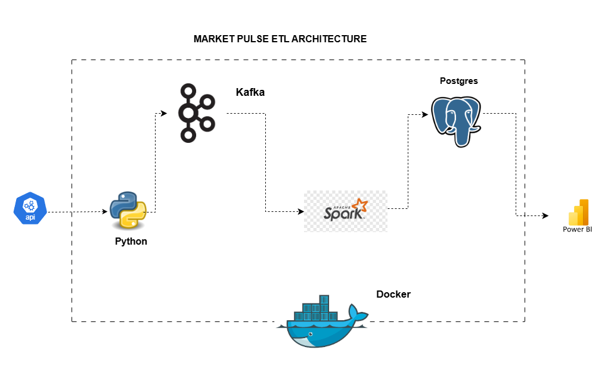
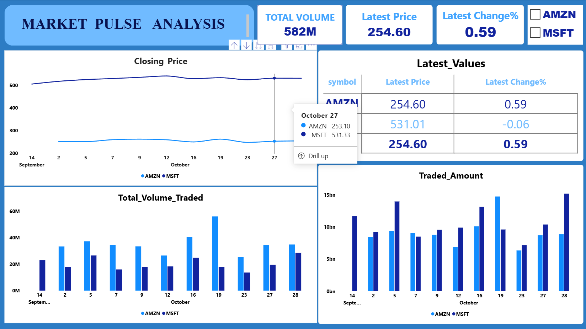

# Market Pulse Analytics

A containerised data pipeline that pulls stock quotes from a REST API, streams them through Kafka, cleans them with Spark Structured Streaming, stores them in PostgreSQL, and visualises them in Power BI.



## How it works

1. **Extract:** a Python producer calls the Alpha Vantage `GLOBAL_QUOTE` endpoint (via RapidAPI) for MSFT and AMZN and publishes each response as JSON to the Kafka topic `raw_api_data`.
2. **Transform:** a Spark Structured Streaming job reads the topic, parses the nested JSON, casts types, strips the `%` from the change percentage, drops rows with missing key fields, and removes duplicates.
3. **Load:** each micro-batch is written to the `stock_quotes` table in PostgreSQL.
4. **Visualise:** Power BI connects to PostgreSQL (Import mode) for the dashboard.



## Stack

| Layer | Tool |
|---|---|
| Ingestion | Python (`requests`, `kafka-python`) |
| Messaging | Apache Kafka (KRaft mode, no ZooKeeper) + Kafka UI |
| Processing | Apache Spark 3.3.0 (standalone master + worker), PySpark Structured Streaming |
| Storage | PostgreSQL 16 + pgAdmin |
| BI | Power BI Desktop |
| Orchestration | Docker Compose |

## Design notes

- **API quota guard:** the free API plan allows only a few requests per day. The producer counts every request (including failed ones) in a state file on a Docker volume, so the limit survives container restarts, and sleeps once the daily cap (`MAX_REQUESTS_PER_DAY`) is reached.
- **Response validation:** responses without a `Global Quote` payload (errors, rate-limit notices, unknown symbols) are skipped instead of being published to Kafka.
- **Deduplication:** Spark drops duplicates within the stream, and the table has a `UNIQUE (symbol, latest_trading_day, price)` constraint so a retried batch cannot silently insert copies.
- **Checkpointing:** Spark's checkpoint lives on a Docker volume, so restarts resume where they left off instead of replaying the topic.

## Getting started

**Prerequisites:** Docker Desktop, and a RapidAPI key subscribed to the Alpha Vantage API.

```bash
git clone https://github.com/Nikken-Ocansey/Market_Pulse_Analytics.git
cd Market_Pulse_Analytics

cp .env.example .env        # on Windows PowerShell: copy .env.example .env
# edit .env and set API_KEY to your RapidAPI key

docker compose up -d --build
```

The first start is slow because Spark downloads the Kafka connector at launch.

### Ports

| Service | URL / port |
|---|---|
| Kafka UI | http://localhost:8080 |
| Spark master UI | http://localhost:9090 |
| Spark worker UI | http://localhost:8081 |
| pgAdmin | http://localhost:5050 |
| PostgreSQL | `localhost:5433` (mapped to 5432 in the container) |
| Kafka (from host) | `localhost:9092` |

### Connecting Power BI

Get Data → PostgreSQL database → server `localhost:5433`, database `pipeline_db`, credentials type **Database**, then load `stock_quotes`.

### Checking the data

```bash
docker exec -it postgres psql -U pipeline_user -d pipeline_db -c "SELECT * FROM stock_quotes ORDER BY ingestion_time DESC;"
```

## Limitations

- The API returns the latest end-of-day quote, so this is a daily-snapshot pipeline, not real-time market data. The request quota limits it to a couple of symbols.
- Credentials in `docker-compose.yml` and the Spark job are local-development defaults. Change them before using anything like this outside your own machine.
- Power BI uses Import mode, so the report needs a manual refresh to show new rows.

## Possible improvements

- Fetch on a fixed schedule after the US market close and skip weekends.
- Replace the plain JDBC append with an `INSERT ... ON CONFLICT DO NOTHING` upsert.
- Move credentials into environment variables.
